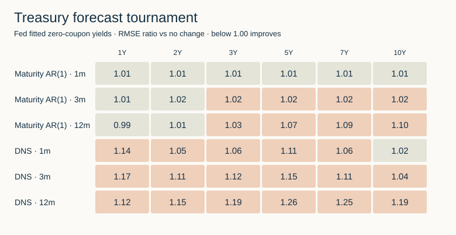

# Treasury yield forecast tournament

Across 310 monthly three-month forecasts and six maturities, **no change had the lowest pooled RMSE (47.57 bp)**. Maturity-specific AR(1) scored 48.48 bp and Dynamic Nelson–Siegel scored 53.15 bp. The target is the Federal Reserve staff’s fitted zero-coupon curve.



[Factor timeline](report/factors.svg) · [Realized vs. predicted 2-year yields](report/forecast.svg) · [Results](RESULTS.md)

## Reproduce

Use Python 3.11–3.14 and curl for downloading the Federal Reserve file.

```sh
git clone https://github.com/NeilMeher/treasury-yield-forecast.git
cd treasury-yield-forecast
python -m pip install -r requirements.txt
python -m unittest -v
python study.py --quick --output pilot
python study.py --download
```

An existing source file can be passed with `python study.py --input path/to/feds200628.csv`. The run checks the month-end snapshot digest, then rebuilds the three figures, accuracy table, and forecast audit. See the [protocol](PROTOCOL.md), [data register](SOURCES.md), and [experiment log](EXPERIMENT.md).

Neil Meher commissioned the work and set the study requirements. Codex implemented and ran the tournament. Neil’s independent review is pending.
